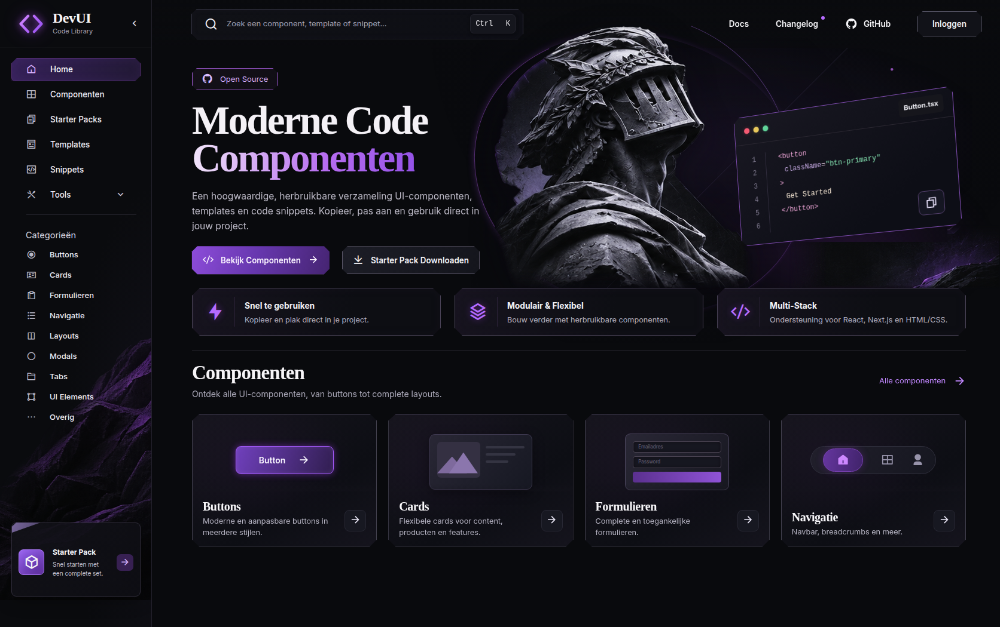

<h1 align="center">DevUI Code Library</h1>

<p align="center">
  Een groeiende collectie React-componenten om te ontdekken, te kopiëren en zelf verder te bouwen.<br />
  Van glowing buttons tot dashboard-cards — gemaakt als creatief frontend-oefenproject.
</p>

## Een kijkje in DevUI

[](https://devui-two.vercel.app/)

## Snel starten

Gebruik **Node.js 22.12+** of **20.19+** en npm.

```bash
git clone https://github.com/itzmitto/DEVUI.git
cd DEVUI
npm install
npm run dev
```
